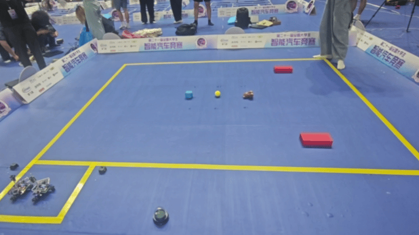

# Vision-Guided-Autonomous-Material-Handling-Robot

### A vision-guided autonomous material-handling robot featuring custom electronics, chassis kinematics, motion control, and closed-loop target alignment.
<div align="center">


</div>

---

## 📖 Overview

This project presents a vision-guided autonomous transport robot developed for a robotics competition.

The robot identifies different targets, moves from the starting area to the target position, performs vision-based closed-loop alignment, and transports each target to its designated zone.

The complete robot was developed from the ground up, including custom electronics, mechanical structures, peripheral drivers, chassis kinematics, motion control, task execution, and vision-based target recognition.

---

## 🎬 Demo



## ✨ Key Features

- 👁️ Vision-based target detection
- 📍 Real-time target-position feedback
- 🎯 Closed-loop target alignment
- 🛞 Chassis kinematics and motion control
- 🧠 Autonomous task execution
- 📦 Target handling and transportation
- 🔌 Custom electronic and mechanical design

---

## 🔄 Workflow

```text
Target Detection
       ↓
Position Estimation
       ↓
Motion Planning
       ↓
Target Approach
       ↓
Closed-Loop Alignment
       ↓
Target Transportation
       ↓
Delivery to Designated Zone
